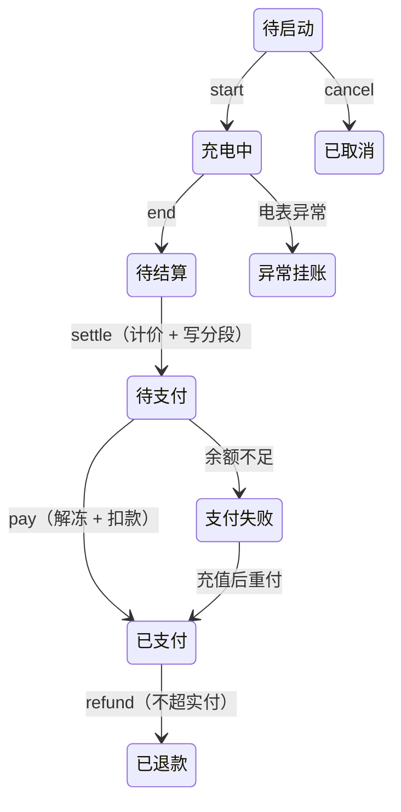

# ChargeOps · 新能源充电桩运营平台

[](https://openjdk.org/projects/jdk/21/)
[](https://spring.io/projects/spring-boot)
[](https://www.mysql.com/)
[](https://redis.io/)
[](#测试)
[](https://github.com/JYKM-silence/ChargeOps/actions/workflows/ci.yml)
[](LICENSE)

面向充电站运营商的后端系统：站点 / 桩 / 枪管理、**分时电价计费**、扫码充电的完整订单链路、
钱包余额冻结与结算，外加一个 RAG + Tool Calling 的 AI 运维助手。

一句话：**「一度电按时段不同价」「钱先冻结、后结算」「一把枪同时只能挂一单」这三件事，
在数据库层面做对** —— 不靠 JVM 锁，靠条件更新与唯一索引。

> P1c（订单链路）与 P2（AI 助手）已完成，P1d（设备上报）未开始。
> **421 个测试通过 / 0 失败 / 1 跳过**（GitHub Actions 在干净的 MySQL 8.4 + Redis 7.4 上跑的）。
> 82 个接口 · 22 张表 · 246 个 Java 文件。

## 界面速览

> 截图跑在前端 mock 模式（`pnpm dev:admin:mock`），数据本地模拟，不需要后端。

| 管理端 · 工作台 | 管理端 · 订单 |
|---|---|
|  |  |

| 管理端 · AI 助手 | 车主端 H5 |
|---|---|
|  |  |

## 为什么它不是 CRUD

| 维度 | 典型 CRUD | 充电桩运营 |
|---|---|---|
| 履约 | 人工点击 | 设备协议驱动，无人介入 |
| 计费 | 固定单价 × 数量 | **分时电价 × 电量**，电费与服务费分列 |
| 订单时长 | 秒级 | 数十分钟到数小时，**横跨多个计费时段** |
| 一致性 | 库存扣减 | **余额冻结 + 三方对账** |

由此得出四条硬约束：跨段计价 `Σ分段 = 总额`；调价不影响在途订单（建单冻结模板 id）；
一把枪同时只挂一单（条件更新，不是 `synchronized`）；设备重报「结束」不能重复扣款。

## 订单生命周期

九个状态、六道「带来源状态的条件更新」。**返回 0 行是正常业务结果** —— 有人做过了，或轮不到你。



钱只在两个时刻被碰：**建单冻结**、**支付时解冻并扣款**；结算只算账，不动钱包。

## 技术栈

| 组件 | 说明 |
|---|---|
| Spring Boot 4.1.1 · Java 21 | Boot 4 的自动配置拆成了独立模块，踩过几个坑 |
| MyBatis + Druid | 状态流转全部写在 XML 的条件更新里 |
| MySQL 8.4 · Redis 7.4 | 唯一索引兜底幂等；Redis 存锁、会话与站点详情缓存 |
| Flyway | V1–V6，表结构的唯一真本 |
| Spring AI 2.0.1 + Ollama | 本机 `qwen3:8b` + `bge-m3`，**零 API key** |
| pgvector | 只服务知识库检索，和业务库分开 |

## 快速开始

```bash
docker compose up -d --wait          # MySQL 13306 / Redis 16379 / pgvector 15432
export CHARGE_OPS_DB_PORT=13306 CHARGE_OPS_REDIS_PORT=16379 CHARGE_OPS_REDIS_DB=0
mvn spring-boot:run                  # 表结构由 Flyway 建好
```

打开 <http://localhost:8081/swagger-ui.html> 就是全部 82 个接口。

| 端 | 账号 | 密码 |
|---|---|---|
| 管理端 | `admin` | `123456` |
| 车主端 | `13900000001` | `123456` |

不想用 Docker、要装 Ollama、想用 curl 把「充值 → 建单 → 上报 → 结算 → 支付」走一遍 ——
见 **[docs/运行与演示.md](docs/运行与演示.md)**。

## 测试

```bash
mvn test        # 421 个用例；需要 MySQL + Redis，不需要 Ollama
```

按层次分四类：纯单测（计费算法、四条登录分支、默认车不变量）、Mapper 集成（唯一索引、CAS、
乐观锁）、Service 集成（整条订单链路，含两线程并发建单）、定时任务。
集成测试**刻意不加 `@Transactional`** —— 加了就永远测不到「失败时钱有没有留在冻结里」。

## 设计要点

- **计费是纯函数**：`BillingEngine` 不读时钟、不读库，可脱离 Spring 穷举单测；`Σ分段金额 = 总额` 是定义出来的恒等式，不是对账出来的
- **状态流转全是带 `from` 的条件更新**，按影响行数裁决，0 行区分冲突 / 幂等重放 / 非法流转
- **钱分两列**：`balance` 与 `frozen_amount`，冻结不让可用余额减少；结算多退少补，退款不超实付
- **快照优先**：车牌、计价模板、实付金额都冻结进订单，历史订单不 JOIN 车辆与模板表
- **坏消息写进文档**：24 条设计决策、11 条自审修复，每条都写了「更简单的做法为什么不行」

## 已知缺口

完整表在 [设计决策.md](docs/设计决策.md) 第八节。最值得先看的三条：

- **设备上报端点挂在管理端**：`start` / `end` 收的是电表读数，谁调谁决定这笔单收多少钱。演示可以，上生产要换
- **`pay()` 不看 `pay_method`**：现状自洽，但放开非余额支付那天会直接从余额扣钱，而且不报错
- **无行级权限**：`staff` 有 `role` / `station_id`，拦截器却只带 `currentId`，任何登录的运维都能改任何站点

## 文档

| 文档 | 内容 |
|---|---|
| [设计决策.md](docs/设计决策.md) | 24 条决策的完整论证 + 已知缺口表。**最值得读的一份** |
| [核心代码导读.md](docs/核心代码导读.md) | 跟着走一遍：一笔订单怎么走、钱在哪、枪在哪 |
| [变更记录.md](docs/变更记录.md) | 两轮自审修掉的 11 条 + 路线图，逐条「原来什么样 / 怎么修」 |
| [运行与演示.md](docs/运行与演示.md) | 本地依赖、Ollama 安装、curl 端到端、前端启动 |
| [工程结构.md](docs/工程结构.md) | 目录树、核心表、前端 workspace |
| [AI运维助手.md](docs/AI运维助手.md) | RAG 切片与检索、Tool Calling、Agent 编排到底在哪 |

## 一些约定

- 金额一律 `BigDecimal`，比较用 `compareTo`；中间不舍入，只在最后取整一次
- 时间一律 Java 侧生成、精度到毫秒，不用 `timestamp`
- 并发控制靠条件更新 + 唯一索引，不用 `synchronized`（多实例失效，JDK 21 下还会 pin 住载体线程）
- 不用外键：InnoDB 的外键检查会在父表加共享锁，与高频写入冲突

## License

MIT
