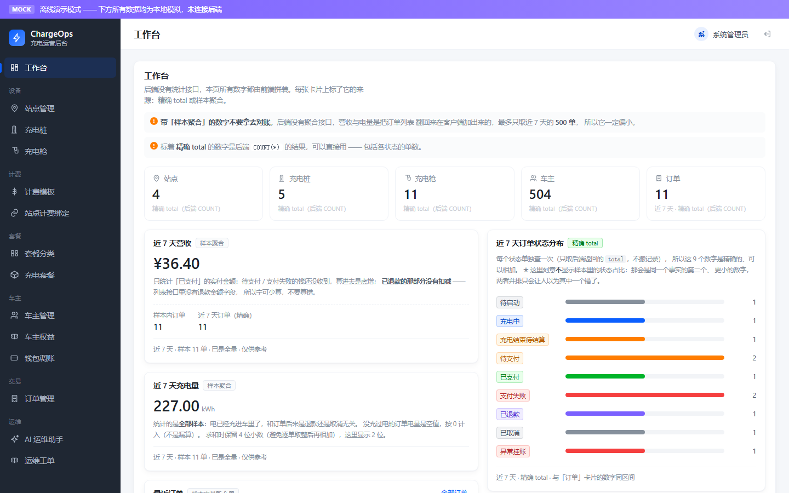
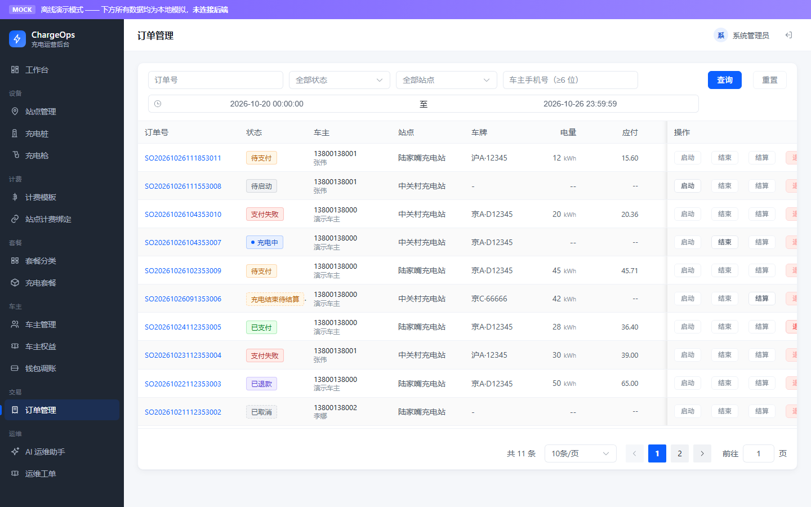
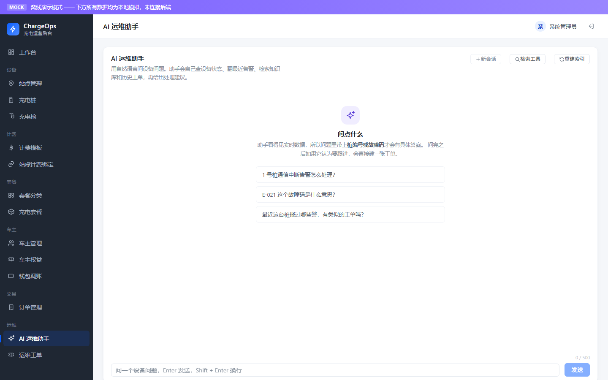
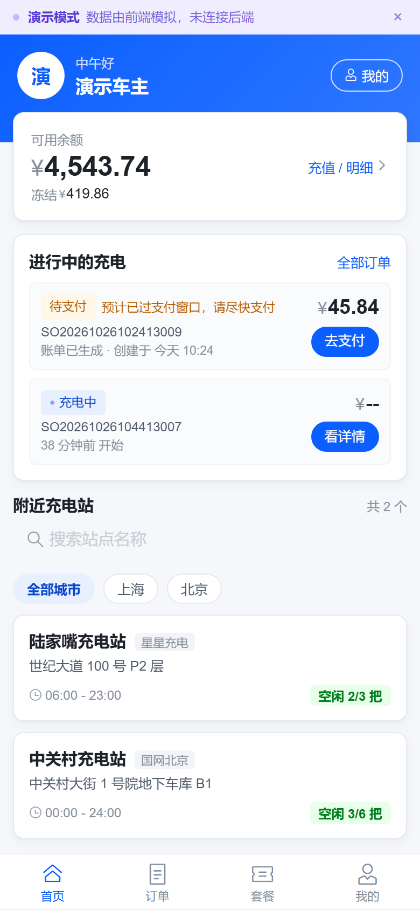
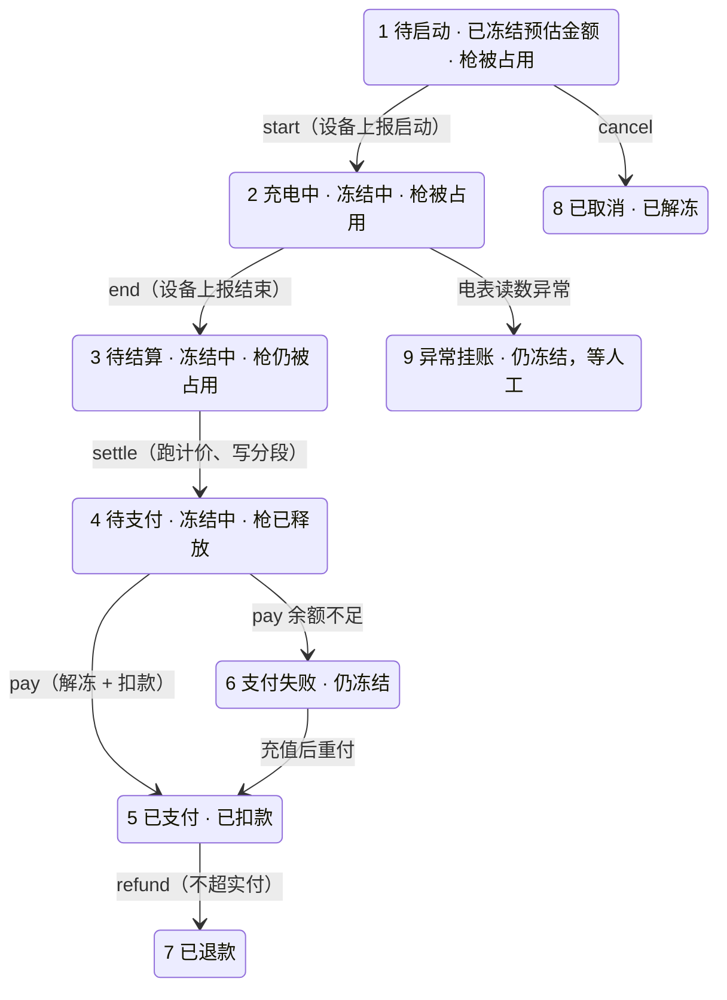

# ChargeOps · 新能源充电桩运营平台

[](https://openjdk.org/projects/jdk/21/)
[](https://spring.io/projects/spring-boot)
[](https://www.mysql.com/)
[](https://redis.io/)
[](#5-跑测试)
[](https://github.com/JYKM-silence/ChargeOps/actions/workflows/ci.yml)
[](LICENSE)

面向充电站运营商的后端系统：站点 / 充电桩 / 充电枪管理、**分时电价计费**、扫码充电的完整订单链路、
钱包余额冻结与结算，以及一个基于 RAG + Tool Calling 的 **AI 运维助手**。

一句话：**把「一度电在不同时段卖不同价」「钱要先冻结、后结算」「一把枪同一时刻只能挂一单」
这三件事在数据库层面做对** —— 不靠 JVM 锁，靠条件更新和唯一索引。

> **状态**：P1c（订单链路）与 P2（AI 运维助手）已完成；P1d（设备上报）未开始。
> **421 个测试通过，0 失败**（`mvn test`，1 条跳过 —— 需要本机 Ollama 的检索评估）。
> 82 个 REST 接口 · 22 张表 · 246 个主代码 Java 文件。

### 5 分钟跑起来

```bash
docker compose up -d --wait          # MySQL 8.4 / Redis 7.4 / pgvector，端口 13306 / 16379 / 15432
export CHARGE_OPS_DB_PORT=13306 CHARGE_OPS_REDIS_PORT=16379 CHARGE_OPS_REDIS_DB=0
mvn spring-boot:run                  # 表结构由 Flyway 在启动时建好
```

打开 <http://localhost:8081/swagger-ui.html> 就是全部 82 个接口，管理端演示账号 `admin` / `123456`。
Windows PowerShell 把 `export` 换成 `$env:CHARGE_OPS_DB_PORT="13306"`，其余同理。
不想用 Docker 的话走 [快速开始](#快速开始) 里的路径 A（本机 MySQL + Redis）。

**目录**

- [界面速览](#界面速览)
- [为什么这个业务的复杂度是真的](#为什么这个业务的复杂度是真的)
- [订单生命周期](#订单生命周期)
- [技术栈](#技术栈)
- [快速开始](#快速开始)
- [项目结构](#项目结构)
- [前端（web/）](#前端web)
- [AI 运维助手（P2）](#ai-运维助手p2)
- [设计决策](#设计决策)
- [路线图](#路线图)
- [两轮补漏（自审记录）](#两轮补漏自审记录)
- [已知缺口](#已知缺口记录在案不是遗漏)
- [跑测试](#5-跑测试)
- [文档索引](#文档索引)
- [一些约定](#一些约定)

---

## 界面速览

> 截图跑在前端的 mock 模式（`pnpm dev:admin:mock`），数据是前端本地模拟的，不需要后端。
> 想看真数据就按上面的「5 分钟跑起来」起后端，再用 `pnpm dev:admin` 连过去。

| 管理端 · 工作台 | 管理端 · 订单管理 |
|---|---|
|  |  |

| 管理端 · AI 运维助手 | 车主端 H5 |
|---|---|
|  |  |

---

## 为什么这个业务的复杂度是真的

充电桩不是「换个名字的电商」——它的难点长在业务本身，不需要硬塞秒杀来制造压力：

| 维度 | 典型 CRUD 业务 | 充电桩运营 |
|---|---|---|
| 履约主体 | 人工操作 | 设备协议驱动，无人介入 |
| 计费方式 | 固定单价 × 数量 | **分时电价 × 充电量**，电费与服务费分离 |
| 订单时长 | 秒级 ~ 分钟级 | 数十分钟到数小时，**横跨多个计费时段** |
| 数据来源 | 用户点击 | **设备上报**（心跳 / 遥测，万级设备高频写入） |
| 一致性难点 | 库存扣减 | **余额冻结 + 三方对账** |

几个直接由此推出的设计约束：

- 一条充电订单可能跨过「低谷 → 平段 → 尖峰」三个时段，结算必须**按时间切分成多段分别计价**，且 `Σ分段金额` 必须严格等于订单总额（否则对不上账）
- **电价会调整，但在途订单和历史订单不能被影响** —— 所以计费模板 id 在下单时冻结进订单，结算阶段完全不碰模板表
- 一把充电枪同一时刻只能有一个订单，两个用户同时扫码必须有一个失败，且**不能靠 `synchronized`**
- 设备会**重复上报**同一条「充电结束」事件，重复上报绝不能重复扣款

---

## 订单生命周期

九个状态、六道「带来源状态的条件更新」闸门。**返回 0 行是正常业务结果**：这一步有人做过了，
或者轮不到你做 —— 调用方按影响行数裁决，而不是靠锁。



钱只在两个时刻被碰：**建单冻结**、**支付时解冻并扣款**；结算只算账，不动钱包。
枪口靠 `connector.current_order_id` + 条件更新保证互斥，取消 / 结算 / 挂账三条路径各自释放。

---

## 技术栈

| 组件 | 版本 | 说明 |
|---|---|---|
| Spring Boot | **4.1.1** | 当前稳定线 |
| Java | **21** | |
| MySQL | 8.4 | 8.0 已停止官方支持 |
| Redis | 7.4 | |
| MyBatis | mybatis-spring-boot-starter 4.1.0 | |
| Druid | druid-spring-boot-**4**-starter 1.2.28 | artifactId 里的 `-4-` 不能少 |
| springdoc-openapi | 3.1.1 | 替代 knife4j / springfox |
| jjwt | 0.12.7 | |
| Jackson | **3**（`tools.jackson.*`） | Boot 4 的默认 JSON 库 |
| Spring AI | **2.0.1** | 唯一引 BOM 的地方。2.0.x 是唯一支持 Boot 4 的线 |
| Ollama | 本机 | 对话 `qwen3:8b` + 向量 `bge-m3`，**零 API key** |
| PostgreSQL + pgvector | 17 / 0.8.7 | 向量库，只服务知识库检索，和业务库（MySQL）分开 |

---

## 快速开始

### 前置条件

- JDK 21、Maven
- MySQL 8（本机服务或 Docker）
- Redis
- PostgreSQL + pgvector（`docker compose up -d pgvector`，见下方第 2 步）
- Ollama + 两个模型 —— **只有 AI 运维助手需要，不装也不影响其余功能**

**Redis 不是只有跑起来才需要**：`@SpringBootTest` 那几个集成测试类会起完整的
Spring 上下文，Redis 连不上就整类报错（不是跳过）。只想验算法规避开这一层的话，
用下面那条「只跑不需要数据库的那部分」的命令（不碰 MySQL 也不碰 Redis）。

**只有 AI 运维助手需要 PostgreSQL+pgvector 和 Ollama，其余功能一条都不依赖它们。**
这一点是实测的，两个方向都验过：

- `AiConfiguration` 里那个向量库 bean 标了 `@Lazy`。它的 `initializeSchema(true)` 会在
  **构造时**连 PG 建表，不加懒加载就是「PG 没起来 → 应用起不来 + 421 条测试一起挂」。
  实测：停掉 pgvector 容器后，和 AI 毫无关系的 `StationServiceImplTest` 5 条全错在
  `Error creating bean with name 'vectorStore'` 上；加 `@Lazy` 之后同一个容器停着的状态下
  该测试类全绿，起回来再跑全量 421 条也全绿。
- 知识库的启动预热被 `chargeops.ai-ops.reload-on-startup=false` 关掉（在 `src/test/` 里），
  所以测试期间不会去调向量模型。

换句话说：**没装 Ollama、没起 pgvector，`mvn test` 照样 421 条全绿**，只是 AI 那几个接口用不了。

### 1. 建库，然后启动应用

**走 Docker（B）时不用建库** —— `MYSQL_DATABASE: chargeops` 已经把它建好了，直接跳到第 3 步。
本机路径（A）先建库，再启动应用：

```bash
mysql -uroot -p < sql/00_create_database.sql    # 只建库，不建表
mvn spring-boot:run                             # 表结构由 Flyway 在启动时建好
```

**表结构不再由手工执行的 SQL 脚本创建**，改由 Flyway 在应用启动时管理。

迁移文件在 [src/main/resources/db/migration/](src/main/resources/db/migration/)：

| 文件 | 内容 |
|---|---|
| `V1__init_schema.sql` | 22 张表的完整 DDL |
| `V2__seed_data.sql` | 种子数据（13 条 `INSERT IGNORE`） |
| `V3__member_package_pay_amount.sql` | `member_package.pay_amount` + `idx_mp_status_expire(status, expire_time)` |
| `V4__ai_ops_schema.sql` | `charger_alarm` + `maintenance_ticket`（AI 运维助手的两张表） |
| `V5__ai_ops_seed.sql` | 告警与工单的种子数据 |
| `V6__demo_member.sql` | 车主端演示账号（`13900000001` / `13900000002`） |

**向量库的表不在这里**：它在 PostgreSQL 里，由 Spring AI 自己建（`AiConfiguration` 的
`initializeSchema(true)`）。Flyway 管的是 MySQL，两个库各管各的 —— 让 MySQL 的迁移去
建 PG 的表，先不说跨库，光是把两套连接信息塞进一个迁移工具就够乱了。

`sql/00_create_database.sql` 只管 `CREATE DATABASE` —— Flyway 连的是一个**已经存在**的库，
它没有权限也没有语义去创建库。`sql/verify.sql` 是一段自检查询（每张表的列数），
不是迁移，它是给人看的。`sql/chargeops.sql`（老的手工脚本）已删除。

三条必须记住的规则：

1. **已应用的迁移永不修改，要改表结构就加 `V4__xxx.sql`。** `validate-on-migrate: true`
 会把「有人改了已应用的迁移」变成一次启动失败（校验和不匹配）。让两台机器的表结构
 悄悄分叉，比在一次启动时报错严重得多。
2. **`baseline-on-migrate: true` 是「相信」，不是「校验」。** 引入迁移之前就存在的老库
 会被记成版本 1 然后**跳过 V1**，Flyway 不会去核对那个库到底是不是 V1 的样子。
 换一台机器、换一个同事的库，都要重新用 `sql/verify.sql` 比对一次。
3. **不要碰 `clean`。** `clean-disabled: true` 已写进配置。在一个 baseline 过的开发库上
 误触发等于一把清空所有测试数据，也永远不要设 `clean-on-validation-error`。

**测试不会帮你跑迁移。** `src/test/resources/application.properties` 里写着
`spring.flyway.enabled=false`，这是有意的：测试库就是开发库，测试假定表已经在那儿了。
于是有一个很贵的坑 —— **写好了 `V4__xxx.sql`、`mvn test` 全绿，但那条迁移一行都没执行过。**
如果新代码用到了新加的列，全量测试会以 `Unknown column ...` 炸掉一批用例，
**而报错指向的是 Service，不是迁移**。加完迁移必须手工 `mvn spring-boot:run` 起一次。

**这个坑在 V4/V5 上真的踩到了，一字不差**：两条迁移写完之后 `mvn test` 是 421 条全绿
（因为当时还没有任何代码碰这两张表），而 `flyway_schema_history` 停在 v3、库里根本没有
`charger_alarm` / `maintenance_ticket`。等测试真正去写它们时，报的是
`Table 'chargeops.maintenance_ticket' doesn't exist` —— 11 条用例一起红，
**而报错指向的是测试夹具，不是「迁移没跑」**。起一次应用之后同一批测试直接全过。

同样，**千万不要用 mysql CLI 手工 `ALTER` 把列加上去**：Flyway 不知道你加过了，
下一次启动会再执行一遍并死在 `Duplicate column name` 上，一个本来只是「忘了启动一次」
的问题变成要手工去修 `flyway_schema_history` 的事故。

> 完整论证在 [docs/设计决策.md](docs/设计决策.md) 第二节：baseline 的实际含义与验数结果、
> `pay_amount` 为什么必须是快照列、`idx_mp_status_expire` 的列序、以及当初为什么必须
> 换掉手工脚本（`CREATE TABLE IF NOT EXISTS` 对已存在的表是空操作）。

### 2. 起依赖

有两条路径，**推荐 B**（也就是上面「5 分钟跑起来」那条，陌生人克隆下来最省事）：

| | MySQL | Redis | 需要的操作 |
|---|---|---|---|
| **B（推荐）** | Docker 13306 | Docker 16379，**db 0** | `docker compose up -d --wait` |
| A | 本机 3306 | 本机 6379，**db 1** | 本机已经装了 MySQL / Redis，不想开 Docker |

B 路径（MySQL / Redis / pgvector 一起起）：

```bash
docker compose up -d --wait        # pgvector 映射到本机 15432
```

A 路径不需要任何环境变量，但 **Redis 必须落在 db 1**：compose 里那套默认 db 0，
同机若还有别的项目（这个仓库当初就和另一个项目共用 3306 / 6379），
共用 db 0 会互相覆盖 key，而且**不会报任何错**。走 A 时把 `CHARGE_OPS_REDIS_DB=1` 显式写上。

### 2.5 装 Ollama 并拉两个模型（可选，只影响 AI 助手）

```bash
# 1) 装 Ollama：https://ollama.com/download
# 2) 拉模型（约 6GB，只拉一次）
ollama pull qwen3:8b      # 对话 + 工具调用，约 5GB
ollama pull bge-m3        # 向量化，约 1.2GB
# 3) 确认它在跑
curl http://localhost:11434/api/tags
```

**不装也能跑**：这两个模型只在 AI 运维助手的接口上用得到，`mvn test` 421 条一条都不碰它们。
首选的对话模型是 `qwen3:8b`（8G 显存够放量化版），显存更大换成 `qwen3:14b` 只需改一个环境变量
`CHARGE_OPS_OLLAMA_CHAT_MODEL`，代码一行不用动。

**★ 实测：直连 `registry.ollama.ai` 在国内网络上会慢到不可用，配代理能快一个数量级。**
模型文件最终落在 Cloudflare R2（`*.r2.cloudflarestorage.com`），这一跳被限得很死。
同一台机器、同一时刻实测：

| 路径 | 速率 | 6GB 要多久 |
|---|---|---|
| 直连 | **75 KB/s** | ~22 小时 |
| 走本地代理 | **1.2 MB/s** | ~1.5 小时 |

Ollama **会读 `HTTPS_PROXY` / `HTTP_PROXY`**，但 Windows 上的托盘程序是登录时自启的，
**拿不到你在某个 shell 里 export 的变量**。所以要让代理生效，得让服务端进程本身带着这两个变量起来：

```bash
# 1) 退掉托盘程序（它会自己拉起一个不带代理的服务）
taskkill //IM "ollama app.exe" //F ; taskkill //IM ollama.exe //F

# 2) 带着代理变量、以后台进程启动服务
export HTTPS_PROXY="http://127.0.0.1:7897" HTTP_PROXY="http://127.0.0.1:7897"
export NO_PROXY="localhost,127.0.0.1,::1"      # 别把自己也代理了
powershell -NoProfile -Command "Start-Process -FilePath \"$LOCALAPPDATA\Programs\Ollama\ollama.exe\" -ArgumentList 'serve' -WindowStyle Hidden"

# 3) 拉模型
ollama pull qwen3:8b && ollama pull bge-m3
```

代理端口按自己那套改（Clash Verge 默认 `7897`，Clash for Windows `7890`，v2rayN `10809`）。

两个附带结论：
- **推理是纯本地的，不需要代理**。模型拉完之后重启机器、让托盘程序照常自启就行，
  上面这套只是「下载时怎么走快路」。
- ★ **manifest 那一跳会偶发 `EOF`**（拉取第一步就失败，跟模型大小无关）。
  实测出现过一次。批量拉模型时**套一层重试循环**，别让一次抖动废掉整轮：

  ```bash
  for m in qwen3:8b bge-m3; do
    for i in 1 2 3 4 5; do ollama pull "$m" && break; sleep 15; done
  done
  ```
  blob 是分片的，重试会**接着已下载的部分继续**，不会白下。

装好之后启动应用，知识库会自动灌一次；改完 `src/main/resources/knowledge/` 下的 markdown
不用重启，调 `POST /api/admin/ai-ops/knowledge/reload` 就行。

### 3. 启动

```bash
# Git Bash 下建议加，否则中文日志可能乱码
export MAVEN_OPTS="-Dfile.encoding=UTF-8"
mvn spring-boot:run
```

应用起在 **8081**（配置里刻意避开常见的 8080）。

### 4. 验证

```bash
# 接口文档
curl -s -o /dev/null -w "%{http_code}\n" http://localhost:8081/v3/api-docs      # 期望 200
# 依赖连通性（db / redis 都应显示 UP）
curl -s http://localhost:8081/actuator/health
# 登录
curl -s -X POST http://localhost:8081/api/auth/staff/login \
     -H "Content-Type: application/json" \
     -d '{"username":"admin","password":"123456"}'
```

管理端业务接口（先拿 token，全部需要 `token` 请求头）：

```bash
TOKEN=$(curl -s -X POST http://localhost:8081/api/auth/staff/login \
  -H "Content-Type: application/json" -d '{"username":"admin","password":"123456"}' \
  | sed -n 's/.*"token":"\([^"]*\)".*/\1/p')

curl -s "http://localhost:8081/api/admin/station/page?pageNum=1&pageSize=10" -H "token: $TOKEN"
```

六个域（`station` / `charger` / `connector` / `package` / `tariff-template` /
`station-tariff`）基本是同一套形状：

| 方法 | 路径 | 说明 |
|---|---|---|
| `POST` | `/api/admin/{域}` | 新建，返回新 id |
| `PUT` | `/api/admin/{域}/{id}` | 修改（局部更新，不传的字段不动） |
| `DELETE` | `/api/admin/{域}/{id}` | 删除（有守卫，见下） |
| `GET` | `/api/admin/{域}/{id}` | 详情 |
| `GET` | `/api/admin/{域}/page` | 分页 |

两处**有意的**不同：

- `station-tariff` **没有 `/page`**，取而代之的是 `GET /by-station/{stationId}`（不分页）。
  绑定永远是按站点查的，而且一个站点的绑定数量以「个」计 ——
  它就是这个站点的调价历史，分页会把最该一眼看全的东西切碎
- `tariff-template` **多一个** `GET /list-enabled`，给「新建绑定」的下拉框用。
  不分页，而且返回的 `rules` 恒为 `null`（一页 10 个模板就是 80 条规则，
  列表页只显示模板名）

业务失败一律是 **HTTP 200 + `{"code":0,"msg":"..."}`**，只有未登录是 401 ——
这不是偷懒，是为了让前端的 axios 拦截器不用给每个调用点写 try/catch。理由写在 `Result` 的类注释里。

反过来说，**如果你看到 `msg` 是「未知错误」，那说明遇到了预期之外的异常**
（堆栈在服务端日志里）。正常的业务失败都有具体文案，例如：

```bash
# 删除还有充电桩的站点
{"code":0,"msg":"该站点下还有 1 个充电桩，请先删除或转移"}
# 用已经改过的 version 改充电枪
{"code":0,"msg":"数据已被他人修改，请刷新后重试"}
# 手工把枪设成「充电中」
{"code":0,"msg":"「已占用」和「充电中」由充电流程自动维护，不能手工设置"}
# 修改已被站点绑定的模板的计费规则
{"code":0,"msg":"该模板已被站点绑定，不能修改计费规则；请新建一个模板版本"}
```

> ⚠️ **Windows / Git Bash 下测带中文的请求体，必须走文件，不能写在命令行里。**
> 控制台代码页不是 UTF-8，`-d '{"name":"科技园站"}'` 发出去的是 **GBK 字节**，
> Jackson 会（正确地）拒绝：`Invalid UTF-8 middle byte 0xd8` → 兜底分支 →「未知错误」。
> 看起来像接口坏了，其实是请求根本没被解析。
>
> 更阴的是**部分中文字符的 GBK 字节恰好构成合法 UTF-8**（例如「野桩」→ `D2 B0 D7 AE`），
> 于是请求成功、字段变成乱码 —— 同一个命令一半成功一半失败，最难排查。
>
> ```bash
> printf '%s' '{"code":"ST-TEST-9001","name":"冒烟测试站"}' > /tmp/st.json
> curl -s -X POST http://localhost:8081/api/admin/station \
>   -H "token: $TOKEN" -H "Content-Type: application/json" --data-binary @/tmp/st.json
> ```

车主端（`/api/member/**`，token 放在 **`authentication`** 请求头 ——
和管理端的 `token` 是两个不同的头、两把不同的密钥，互相验不过）：

```bash
# 注册即登录，直接返回 token。演示车主已经注册过了，
#   重复调用会得到 {"code":0,"msg":"13900000001已存在"} —— 这本身就是撞唯一索引的样子
curl -s -X POST http://localhost:8081/api/auth/member/register \
     -H "Content-Type: application/json" \
  -d '{"phone":"13900000009","password":"123456","nickname":"demo"}'

M=$(curl -s -X POST http://localhost:8081/api/auth/member/login \
  -H "Content-Type: application/json" -d '{"phone":"13900000001","password":"123456"}' \
  | sed -n 's/.*"token":"\([^"]*\)".*/\1/p')

curl -s http://localhost:8081/api/member/me                    -H "authentication: $M"
curl -s http://localhost:8081/api/member/vehicle               -H "authentication: $M"   # 我的车（不分页，个位数）
curl -s -X POST http://localhost:8081/api/member/vehicle       -H "authentication: $M" \
     -H "Content-Type: application/json" -d '{"plateNo":"yuebd12345","brand":"BYD"}'      # 车牌会被规范成 YUEBD12345
# 下面的 {id} 换成上面那个响应的 data[].id —— 用别人的车辆 id 会得到「车辆不存在」
curl -s -X PUT  http://localhost:8081/api/member/vehicle/{id}/default -H "authentication: $M"
curl -s -X PUT  http://localhost:8081/api/member/me/password   -H "authentication: $M" \
     -H "Content-Type: application/json" -d '{"oldPassword":"123456","newPassword":"newpass456"}'
```

### 充电链路（P1c-3）端到端

订单是**双身份**的：车主只能建单 / 取消 / 支付，
而**决定用了多少电、因而决定金额的那两步在管理端** ——
`start` / `end` 收的是**电表读数**，让用户自己填就等于让用户自己决定付多少钱。
`$M` 是车主 token，`$TOKEN` 是管理端 token。

```bash
# 1. 充值
curl -s -X POST http://localhost:8081/api/member/wallet/recharge \
 -H "authentication: $M" -H "Content-Type: application/json" -d '{"amount":"100.00"}'

# 2. 建单 —— 冻结「下单这一刻」的计费模板 + 一份预估金额，返回订单 id
OID=$(curl -s -X POST http://localhost:8081/api/member/orders \
 -H "authentication: $M" -H "Content-Type: application/json" \
 -d '{"stationId":1,"chargerId":1,"connectorId":1,"vehicleId":1}' \
 | sed -n 's/.*"id":\([0-9]*\).*/\1/p')
# 枪被别人占着、或这辆车已有进行中的订单 → code:0（不是 500）
# 可用余额付不起预估冻结额 → 直接拒绝，订单根本建不出来

# 3~5. 设备上报启动 → 上报结束 → 结算（管理端，由运维代为录入）
curl -s -X POST http://localhost:8081/api/admin/orders/$OID/start -H "token: $TOKEN" \
 -H "Content-Type: application/json" -d '{"startMeterKwh":"1000.0000"}'
curl -s -X POST http://localhost:8081/api/admin/orders/$OID/end -H "token: $TOKEN" \
 -H "Content-Type: application/json" -d '{"endMeterKwh":"1010.0000"}'
curl -s -X POST http://localhost:8081/api/admin/orders/$OID/settle -H "token: $TOKEN"

# 6. 支付 —— 先改订单状态、再动钱包，同一个事务
curl -s -X POST http://localhost:8081/api/member/orders/$OID/pay -H "authentication: $M"

# 7. 详情：含分段明细 + 完整流转历史
curl -s http://localhost:8081/api/member/orders/$OID -H "authentication: $M"
```

**3~6 每一步都是幂等的**，而且幂等手段是**状态条件更新**不是唯一索引：
把上面任意一条**连发两次**，第二次得到的是 `code:0`（「订单当前状态不允许该操作」），
**不是重复扣款**。设备重复上报同一条「结束」事件走的就是这条路径 ——
这也是它必须靠 `status` 判断、而不能 catch 钱包侧唯一索引异常的原因
（那个异常抛出时事务已被标记回滚，见 `WalletService` 类注释）。

订单状态与「钱在哪」的对应关系（完整流转表见 `OrderStatus` 类注释）：

| 状态 | | 钱 |
|---|---|---|
| `1` 待启动 / `2` 充电中 / `3` 待结算 | 进行中 | **冻着** |
| `4` 待支付 / `6` 支付失败 | 已结束、没付成 | **冻着**（6 也能重新付，见决策 17） |
| `5` 已支付 | 完成 | 已扣 |
| `7` 已退款 / `8` 已取消 | 终态 | 已退 / 已解冻 |
| `9` 异常挂账 | 挂起，**不是终态** | **还冻着** —— `markAbnormal` 只释放枪口、不动钱包，等人工核销。见决策 16 |

**`4 待支付` 和 `6 支付失败` 都是安全的停留状态** ——
钱在冻结里、订单可重试，充值后原样再 `pay` 一次即可。

管理端还剩两个域，和上面六个形状不同：

| 路径 | 端点 |
|---|---|
| `/api/admin/category` | 五端点，同六域 |
| `/api/admin/member` | 只有 `GET /page`、`GET /{id}`、`PUT /{id}/status` —— **刻意没有新建和硬删**，见下方缺口与 `MemberAdminController` 的类注释 |

跨身份越权必须**真的跑一次**，不能靠推理：

```bash
curl -s -o /dev/null -w "%{http_code}\n" http://localhost:8081/api/member/vehicle \
     -H "authentication: $TOKEN"        # 管理端 token 打车主端 → 401
curl -s -o /dev/null -w "%{http_code}\n" "http://localhost:8081/api/admin/station/page?pageNum=1&pageSize=5" \
     -H "token: $M"                     # 车主 token 打管理端 → 401
```

Swagger UI：<http://localhost:8081/swagger-ui/index.html>
（`/swagger-ui.html` 会 302 跳到这里，是 springdoc 的正常行为，不是错误。）

开发环境还开了 Druid 监控页 <http://localhost:8081/druid/>（admin/admin，**仅 dev**）。

### 5. 跑测试

```bash
mvn test
```

当前 **421** 条（0 失败 / 1 跳过）测试（`mvn -o test` 的汇总行；0 失败 / 0 错误 / 0 跳过），分四类：

| 类别 | 需要 MySQL/Redis | 内容 |
|---|---|---|
| 纯单测 | ❌ | `BillingEngineTest` / `TariffValidatorTest`（计费算法）、`ChargePackageServiceImplTest`、`MemberServiceImplTest`（四条登录分支 + token 签发）、`VehicleServiceImplTest`（默认车不变量）。判据是**类上没有 `@SpringBootTest`** —— 不加载容器，所以不碰数据库 |
| Mapper 集成 | ✅ | 13 个 `*MapperTest`：审计字段、`24:00:00` 往返、乐观锁、唯一索引的枪口互斥、`refreshGunCount`、排序规则 `ai_ci`/NO PAD 的实测行为、`member_package` 的锁定互斥与结算幂等、 `charging_order` 的六道状态闸门、 `ConnectorMapperTest` 的四条 CAS（占用 / 启动 / 结束 / 释放）与 `incrementChargeCount` |
| Service / Controller 集成 | ✅ | `WalletServiceImplTest`（冻结 / 解冻 / 扣款的钱不变量 + `ADMIN_ADJUST` 的**符号**）、`ChargingOrderServiceImplTest`（整条订单链路：建单冻结 → 结算计价 → 支付扣款，含**两条线程的并发建单** + 转挂账时必须**释放权益锁**）、`MemberPackageServiceImplTest`（四种 `PackageType` 的直购 + 作废退款：先 CAS 后打款）、`StationServiceImplTest` / `ChargerServiceImplTest` / `MemberStationServiceImplTest`（删除守卫与站点查询）、`FileUploadControllerTest`（上传的**校验顺序**：先按扩展名拒绝，再读字节）、**`OpsToolsTest`（11 条：坏输入下不抛异常、召回只取 `status=2` 的工单、`alarm_id` 挂错桩时丢弃关联但仍建单）、`MaintenanceTicketServiceImplTest`（7 条：`updateStatus` 改成同值必须是 no-op）** |
| 定时任务 | ✅ | `ChargingOrderSweepJobTest`（支付失败兜底扫描：账龄按 `settle_time`、**绝不自动重试 `pay()`**、单笔失败不带走一轮）、`MemberPackageExpireJobTest`（过期扫描：**被订单锁着的一份都不能动** —— 动了它那份权益就永远退不了款）—— 被测对象都是 `new` 出来的，**不是** `@Autowired`：`chargeops.scheduling.enabled=false` 让那两个 Bean 根本不存在（见下），任务方法直接调一次就等于扫全表，不需要 `@EnableScheduling`。`orderService` 仍来自容器，所以 `markPayFailed` 的独立事务是真的 |

Mapper 与 Service 集成测试都用 `@SpringBootTest`，需要本机 MySQL **和 Redis** 都可用。
这两个 Service 测试**刻意不标 `@Transactional`** —— 标了的话整个测试跑在一个会回滚的
事务里，「失败时钱有没有留在冻结里」这类断言就永远测不到真相。

**所以：一个时刻只能有一个 `mvn test` 在跑。** 

测试之间靠 `TEST_ID_BASE` 哨兵区间隔离（2e12 钱包 / 3e12 订单 Mapper / 4e12 订单 Service /
5e12 权益 / 6e12 站点 / 7e12 桩 / 8e12 兜底扫描 / 9e12 权益过期 / 11e12 AI 工具 / 12e12 工单），**但这些区间是一个方向开口的** ——
收尾写的是 `DELETE ... WHERE member_id >= TEST_ID_BASE`，于是一个 3e12 的类
会连 6e12 的行一起删。串行跑没有任何问题（前一个类的 `@AfterEach` 早就跑完了），
**但两个 `mvn test` 并行时会互相删数据**，症状是「刚插进去的订单凭空消失」：
断言里出现 `expected: 2L but was: 0L`，而且单独跑永远是绿的。
surefire 默认单进程串行，正常使用不会碰到；**并行化测试之前必须先把这个范围封口**。

**这一层不是装饰**：`ConflictingBeanDefinitionException` 那个 bug（见决策 9）
能过 `mvn compile`、能过 IDE 检查，**只有起容器才会暴露** ——
抓到它的正是这组 `@SpringBootTest`。写 Mapper 测试的收益不只是「SQL 写对了没」。

只跑不需要数据库的那部分（最快的反馈环，不碰 MySQL）：

```bash
mvn test -Dtest='BillingEngineTest,TariffValidatorTest,ChargePackageServiceImplTest,MemberServiceImplTest,VehicleServiceImplTest,FileUploadControllerTest'
```

两个单测里各有一条值得单看的写法：

- `MemberServiceImplTest` 用一个 `CountingPasswordEncoder` 装饰真 BCrypt，
  断言**前三种登录失败一次密码比对都没发生** —— 「把最慢的一步放最后」这句设计
  只断言「抛了哪个异常」是证明不了的
- `VehicleServiceImplTest` 用手写的**内存假库**而不是记录调用的桩，因为要验的是
  **一串操作之后的状态**（「有车的车主一定有且只有一辆默认车」）。
  假库的每条语句都对着真 `VehicleMapper.xml` 抄了承重条件（`id <> #{id}`、
  `WHERE` 里的 `member_id`、`is_default` 的 NOT NULL）——
  一个比真库宽松的假库会让测试通过而生产失败，那比没有测试更糟

---

## 项目结构

```
src/main/java/com/chargeops/
├── annotation/       @AutoFill —— 公共字段自动填充标记
├── mybatis/          AutoFillInterceptor —— 填充的落地实现（MyBatis 插件）
├── config/           WebMvc / Jackson / Password / Storage 配置
├── context/          BaseContext —— 基于 ThreadLocal 的当前登录者
├── interceptor/      JWT 鉴权拦截器（管理端 / 车主端两套）
├── controller/       admin（管理端）/ user（车主端）—— 两侧的类名都自带作用域，见下方决策 9
├── billing/          BillingEngine / TariffValidator / TariffRuleSnapshot 等 —— 纯函数计费内核
├── service/ mapper/ entity/ dto/ vo/   业务分层（service 接口 + impl 各 12 个）
│   └─ P1c-2 起新增：WalletService / ChargingOrderService，
│      以及 ChargingOrderMapper（全部状态流转都是带 from 的条件更新）、
│      ChargingSegmentMapper / ChargingOrderEventMapper / WalletMapper / WalletTransactionMapper
├── ai/               OpsTools —— AI 运维助手的工具集（4 个 @Tool 方法），见下方「AI 运维助手」
├── job/              ChargingOrderSweepJob / MemberPackageExpireJob —— 兜底扫描，
│                    都受 `chargeops.scheduling.enabled` 管着（测试里是 false）
├── handler/          GlobalExceptionHandler —— 统一异常翻译
├── redis/            CacheClient / RedisData / RedisJsonUtil —— 缓存与逻辑过期
├── properties/       JwtProperties / StorageProperties / SchedulingProperties
├── utils/            JwtUtil / FileStorage + LocalFileStorage / TimeCodec / BizNoGenerator
└── constant/ exception/ result/ enumeration/    基础件

src/main/resources/knowledge/          知识库语料（3 份 markdown），改动后调 POST /knowledge/reload
    ├── 故障码说明.md                   按故障码组织，二级标题 = 一个故障码
    ├── 运维手册.md                     按处理动作组织
    └── 常见问题.md                     按用户问法组织

src/main/resources/db/migration/
    V1__init_schema.sql                22 张表的完整 DDL（含每条索引的设计理由）
    V2__seed_data.sql                  种子数据（13 条 INSERT IGNORE）
    V3__member_package_pay_amount.sql  退款要用的实付快照 + 过期扫描的索引
    V4__ai_ops_schema.sql              charger_alarm + maintenance_ticket
    V5__ai_ops_seed.sql                告警与工单的种子数据
    V6__demo_member.sql                车主端演示账号，README 的端到端演示要用
        表结构的唯一真本。要改结构就加 V6，不要改已应用的任何一条；
        测试不会替你跑迁移，加完必须手工起一次应用（见上）
sql/00_create_database.sql             建库（Flyway 管不了 CREATE DATABASE）
sql/verify.sql                         自检查询，给人看的，不是迁移
docker-compose.yml                     本地依赖（pgvector 在必选路径 A 里也要起）
```

**P1c-3 新增的 5 张表**（都在 `V1__init_schema.sql` 里）：

| 表 | 作用 | 一个要点 |
|---|---|---|
| `charging_order` | 订单主体，9 个状态 | 存**快照列**（`plate_no` / `tariff_template_id` / `member_package_id` / `frozen_amount`），结算时**不 JOIN** `vehicle` / `station` —— 车牌改了、模板调价了，都不该改动历史订单 |
| `charging_segment` | 结算产出的计费分段，`uk(order_id, seq)` | 列与 `BillingResult` 逐字段对应，没有转换层 |
| `charging_order_event` | 状态流转流水（**append-only**） | 记录「谁改的」—— 因为 `update_user` 对设备上报路径没有意义，见 `ChargingOrderMapper` 类注释第二节 |
| `wallet` | 余额 / 冻结，`uk(member_id)` | `balance` 与 `frozen_amount` **必须分两列**：冻结不能让可用余额减少，否则那就叫直接扣款 |
| `wallet_transaction` | 流水，`uk(order_id, type)` | 它是**最后一道防线**，不是幂等手段 —— 见下方决策与 `WalletService` 类注释 |

单模块。分层包结构与教程形态一致，后期要拆多模块是纯机械操作。

**演示账号**：

| 端 | 账号 | 密码 | 说明 |
|---|---|---|---|
| 管理端 | `admin` | `123456` | 请求头 `token` |
| 车主端 | `13900000001` | `123456` | 自助注册的演示车主，请求头 `authentication` |
| 车主端 | `13900000002` | `123456` | 第二个车主，用于验证「看不到别人的车」 |
| 车主端 | `13800000001` | — | 种子数据，`password IS NULL`，**无法用密码登录**（DDL 里这是合法状态，对应将来的验证码登录） |

---

## 前端（`web/`）

前端是**独立的一个 workspace**，不在 `src/` 里，也不参与 Maven 构建：

```
web/
├── packages/admin    Vue 3 + TypeScript + Element Plus :5173 运维后台（52 个接口）
├── packages/h5       Vue 3 + TypeScript + Vant 4 :5174 车主手机端（25 个接口）
└── packages/shared   纯 TS（无 .vue）—— HTTP / 类型 / 字典 / 领域规则 / Mock
```

```bash
cd web && pnpm install
pnpm dev:admin      # 连真后端（/api 经 vite proxy 转发到 :8081）
pnpm dev:h5
pnpm dev:admin:mock # 纯前端 Mock，不需要 MySQL / Redis
pnpm build          # 两端构建；类型检查是前置步骤
```

> **前端不直连 8081**。后端零 CORS，且鉴权头是自定义头（`token` / `authentication`），
> 必然触发 `OPTIONS` 预检而被 JWT 拦截器打成 401 —— 所以开发期一律走 Vite 同源代理。
> 上线必须用 Nginx 同源反代 `/api` 与 `/img`。

详细的启动方式、演示账号、Mock 场景、架构约定、**10 条已知限制**与排错表
都在 [`web/README.md`](web/README.md) —— **改前端之前先读它第 6 节**。

### 为 H5 补的两个车主端接口（Phase 0.5）

H5 的充电入口原本是断的：建单需要 `stationId` / `chargerId` / `connectorId` 三个数字，
而车主端**没有任何接口能拿到它们**（`MemberStationPageQueryDTO` 的类注释原话是
「三个 id 在车主端没有任何合法来源」「前端也只能让用户手输三个数字」）。

新增 **1 个 Controller + 1 个 Service/Impl**，复用现成零件，**不修改任何既有类**：

| 新接口 | 复用的零件 |
|---|---|
| `GET /api/member/station/page` | `MemberStationPageQueryDTO` + `StationMapper.pageForMember`（SQL 内写死 `status = 1`）+ `ConnectorMapper.countByStationIds` |
| `GET /api/member/connector/by-station/{stationId}` | `ConnectorMapper.listByStation` + `MemberConnectorVO.from(...)` |

### 前端**必须**知道的 5 条后端事实

这几条都会直接改变 UI 行为，写在这里免得每次都要回到 Java 源码里翻：

1. **`pay` 的 CAS 是 `status IN (4, 6)`** —— 「6 支付失败」**可以重新支付**（6→5），不是死胡同。
 → H5 详情页对 6 必须有「重新支付」按钮，不能只引导充值。
2. **`listByStation` 不排序**（`gun_no` 是字符串，排出来是 `1, 10, 2`）——
 后端注释明确要求**前端重排**。见 `h5/src/api/station.ts` 的 `sortConnectors()`：
 先可用、再按桩分组、枪号用 **`numeric: true` 的自然序**。
3. **`available` 是快照不是预订** —— 前端必须处理「`available=true` 但建单失败」这个分支
 （正常并发，不是 bug），失败时要**重新拉枪列表**并提示换一把。
4. **建单即按预估价冻结余额** —— 所以建单失败最常见的原因是**余额不足**而不是枪不可用。
 两种失败要引导到不同地方（充值 / 换把枪），但后端只给一句中文 msg，只能按文案分流。
5. **`eventType === 'abnormal'` 有两种含义**（余额不足时后端自己把 4→6，以及其他异常）——
 事件流渲染**必须结合 `fromStatus`/`toStatus`**，不能只看 `eventType`。
 且 `fromStatus`/`toStatus` 是**裸 Integer 没有 label**，前端自建了状态码→中文表。

### 前端侧的对称约定

- **`code === 1` 是成功**；业务失败是 **HTTP 200 + `code:0` + 中文 msg**。
- **HTTP 401 且响应体为空** → 跳登录（**幂等**，并发多个 401 只跳一次）。
- **`code:0` 且 msg 是「登录状态已失效，请重新登录」也要登出** ——
 那是 `BaseContext` 为空时 Service 层的形状，与拦截器 401 是**两条不同路径**。
- **禁用探针的判据是「HTTP 200 且 `status === 0`」**，不是 HTTP 状态码 ——
 后端禁用返回的是成功。**且探针必须软失败**：断网/超时绝不登出。
- **防重 4 层**：按钮级 `useSubmitLock` + 业务级 `withActionLock`
 （专挡后端**没有幂等键**的资金动作）+ GET 合并 + **不做乐观更新**。
- 前端**不按 role 隐藏菜单** —— 后端没有行级权限，隐藏只会制造
 「有权限却看不到」的假象（见下方已知缺口）。

---

## AI 运维助手（P2）

充电桩运维原来靠人翻手册、对故障码，一个「E-021 通信中断」要查三份文档。这一节做的事是
让运维直接问：「7 号桩通信中断告警怎么处理」，由助手去查实时状态、查历史工单、查手册，
把结论和处理步骤一次性给出来。

对话模型是本机的 **Ollama + `qwen3:8b`**，向量模型是 `bge-m3`，**零 API key**。

### 三个能力落在哪

| 能力 | 在代码里的位置 | 做了什么 |
|---|---|---|
| **RAG 知识库问答** | `KnowledgeBaseServiceImpl` + `AiOpsServiceImpl.systemPrompt` | 三份 markdown 按 `## ` 切片 → `bge-m3` 向量化 → 存 pgvector。提问时先检索 topK 片段，拼进系统提示词再生成 |
| **Tool Calling** | [`ai/OpsTools.java`](src/main/java/com/chargeops/ai/OpsTools.java) | 4 个 `@Tool` 方法，模型自己决定调哪个、参数填什么 |
| **Agent 编排** | `AiOpsServiceImpl.chat` | 见下方「Agent 到底在哪里」 |

**4 个工具**：

| 工具 | 回答什么问题 |
|---|---|
| `getPileStatus(pileId)` | 这台桩现在什么状态？每把枪呢？最后心跳是什么时候？ |
| `getRecentAlarms(pileId)` | 最近报过什么警？哪个故障码？恢复了没？ |
| `findSimilarResolvedTickets(alarmCode)` | 这个故障码以前是怎么修的？（**只取已完成的工单**） |
| `createMaintenanceTicket(chargerId, title, content, alarmId)` | 派个单给运维 |

### Agent 到底在哪里

**这里没有硬编码的编排代码**，`chat()` 里也不存在「先查状态、再查告警、最后建单」这样的流程。
`AiOpsServiceImpl.chat` 只做三件事：检索知识库 → 把片段拼进系统提示词 → 发一次
`chatClient.prompt().tools(opsTools)`。

**多步是模型自己走的**：它看到问题后决定先调 `getRecentAlarms` 拿故障码，拿到之后再调
`findSimilarResolvedTickets` 查历史，觉得信息够了就组织答案，判断需要派人时才调
`createMaintenanceTicket`。Spring AI 负责的是工具调用的**协议**（把 `@Tool` 方法的签名
翻译成模型能懂的 schema、解析它吐回来的调用请求、执行、把结果塞回对话再问一轮）。

所以「Agent 编排」在这个项目里的正确说法是：**编排是模型的行为，不是我们的代码**。
我们的代码负责的是**把工具设计好** —— 边界清楚、坏输入不抛异常、返回值模型读得懂
（见决策 24）。这也是为什么 `OpsTools` 里有一半的代码在处理「模型编了个不存在的 id」。

一次**典型**的调用链（问「1 号桩通信中断告警怎么处理」；实际顺序和调不调某个工具由模型决定）：

```
模型 → getRecentAlarms(1)              → 拿到 E-021，未恢复
     → findSimilarResolvedTickets("E-021") → 拿到 3 条历史工单的处理结论
     ← 知识库片段里 E-021 的处理步骤（检索发生在第一轮之前）
     → 组织答案；如果用户说「派单」 → createMaintenanceTicket(...)
```

### 5 个接口

```bash
# 提问（多轮：把上一轮返回的 sessionId 带回来，就记得上下文）
curl -X POST localhost:8081/api/admin/ai-ops/chat \
  -H 'token: <管理端 token>' -H 'Content-Type: application/json' \
  -d '{"question":"1号桩通信中断告警怎么处理"}'

# 只检索、不调模型 —— 排查「知识库没内容」还是「模型没用好内容」
curl 'localhost:8081/api/admin/ai-ops/knowledge/search?query=E-021' -H 'token: <token>'

# 改完 knowledge/ 下的 markdown 后重建索引，不用重启（幂等）
curl -X POST localhost:8081/api/admin/ai-ops/knowledge/reload -H 'token: <token>'

# 工单列表 / 改状态
curl 'localhost:8081/api/admin/maintenance-ticket/page?status=0' -H 'token: <token>'
curl -X PUT localhost:8081/api/admin/maintenance-ticket/1/status \
  -H 'token: <token>' -H 'Content-Type: application/json' -d '{"status":2}'
```

`chat` 是**同步**的，一次请求要等模型多轮往返，耗时按秒计 —— 读超时配在
`spring.http.clients.read-timeout`，那里给的 60 秒就是上限。流式（SSE）在 P2.5。

### 两条值得知道的实现约束

- **RAG 是手写的，不是 `QuestionAnswerAdvisor`。** 那个类在 Spring AI 2.0 里**不存在**。
  手写之后反而多了一个排查接口（只检索不生成）。见决策 20。
- **`OpsTools` 上不能加 `@Transactional` 之类的注解。** `.tools(bean)` 不做 AOP 方法解析，
  代理之后 `@Tool` 注解读不到，失败方式是**工具一个都不注册、且日志里什么都没有**。见决策 21。

### 追问改写（已实现）

**「那第二点具体怎么做」这类问题，整句向量化后召回为空** —— 句子里没有任何实词。
修法是先做一次**查询改写**：过一道指代启发式闸门（出现「那 / 它 / 第二点 / 呢」这类特征词
才值得多花一次模型调用），命中后用**独立的 `ChatClient`** 把问题补全成
「E-021 的第二步具体怎么做」，**只用于检索**；真正发给对话模型的仍是用户原话。

为什么要独立 `ChatClient`：挂记忆 advisor 的那个走一遍「系统提示 + 历史 + 改写指令 → 结果」，
这次往返会被写进会话历史 —— 用户下一轮会看到一段自己没说过的话，而改写指令本身是元语言，
模型很容易把它当成业务内容接着聊。

任何一步失败都退回原问题：改写是锦上添花，不该让一次本来能回答的问答变成报错。
评估集里专门有一组「追问」样本量这件事（`RagRetrievalEvalTest`，默认不进 `mvn test`）。

---

## 设计决策

这个项目里有一批「看起来可以更简单、但不能更简单」的地方。完整的 24 条论证在
**[docs/设计决策.md](docs/设计决策.md)**，下面只列一句话摘要当索引：

| # | 决策 |
|---|---|
| 1 | `@AutoFill` 为什么是 MyBatis 插件，不是 AOP 切面 |
| 2 | `connectionTimeZone` 必须写 `+08:00`，不能写 `Asia/Shanghai` |
| 3 | `datetime(3)` 的精度与四舍五入 |
| 4 | `WebMvcConfigurer`，不是 `WebMvcConfigurationSupport` |
| 5 | 依赖版本上的两个坑 |
| 6 | `DEFAULT` 只在字段**缺席**时生效 —— 两个把 null 变成 500 的机制 |
| 7 | 计费模板的规则**不可变**，而这正是 `station_tariff` 存在的理由 |
| 8 | 两个只有跑起来才发现的 bug |
| 9 | 两个同名 Controller **能编译、能过 IDE、在启动那一刻炸** |
| 10 | 「每车主至多一辆默认车」**不可能用唯一索引表达** |
| 11 | 车牌转大写**不是为了唯一性**，`trim()` 才是 |
| 12 | 唯一键拆成 `uk(type, name)` 之后，**消费方必须知道自己要哪个 type** |
| 13 | MySQL 的 `SET` 子句**从左到右求值**，后面的子句看得见前面刚改的值 |
| 14 | 折扣按「**被覆盖的**数量」算，扣减就必须按**同一个数** |
| 15 | `tryLockPackage` 里的一个无条件 `break`，让只有非电量包的车主永远选不中 |
| 16 | 挂账的来源是「**钱还冻着**」的订单，不是「**枪还占着**」的订单 |
| 17 | `6 支付失败` 曾经是个死胡同；顺带记两条钱包的顺序后果 |
| 18 | 套餐作废：**先 CAS，再打款** —— 反过来写就是一台重复退款的机器 |
| 19 | `spring.ai.model.*` 的默认值是「自动装配」，关掉它必须显式写 `none` |
| 20 | Spring AI 2.0 里没有 `QuestionAnswerAdvisor`，RAG 是手写的（而这反而是升级） |
| 21 | `.tools(bean)` 的 bean 一旦被代理，`@Tool` 会**静默地一个都不注册** |
| 22 | `@ConditionalOnMissingBean` 按**方法返回类型**匹配 —— 一个词的差别 |
| 23 | 向量库**不能**注册成 `DataSource` bean —— 否则 Druid 退避，业务 SQL 全打到 PG 上 |
| 24 | 工具方法一律返回 `String`，不返回实体、不抛异常 |

两条贯穿全局的读法：

- **状态流转一律用带 `from` 的条件更新（CAS），返回 0 行是正常业务结果，不是异常。**
 这把「并发」变成了一条 SQL 谓词，而不是一把锁。
- **钱包全程只被碰两次**：创建订单时冻结，支付时解冻并扣款。`settle` 不碰钱包。

---
## 路线图

```
P0 骨架+DDL ✅ ──┬── P1a 站点/桩/枪/套餐/模板 CRUD ✅ ──┐
                 └── P1b 计费引擎(纯函数+单测) ✅ ──────┼── P1c 订单链路
                        P1c-1 车主端底座 ✅ ────────┤
                      P1c-1.5 权益表结构 ✅ ────────┤
                     P1c-2 钱包 ✅ ──────────────┤
                        P1c-3 订单状态机 ✅ ────────┤
                            收尾 两轮补漏 ✅ ────────┘
                                               │
                            P1d 设备上报 ──────────┤
                                               │
                           P2 AI 三件套 ──────────┤
                              P3 稳定性与异步 ───────┤
                             P4 数据层加深 ─────────┘
```

| 阶段 | 内容 |
|---|---|
| **P0** ✅ | 建库建表 + 骨架 + 基础设施 + 登录鉴权 |
| **P1a** ✅ | 站点 / 充电桩 / 充电枪 / 套餐 / 计费模板 / 站点计费绑定 六个域的管理端 CRUD（31 个接口：5×5 + 模板 6 个含下拉框 + 绑定 5 个按站点查） |
| **P1b** ✅ | `BillingEngine`（纯函数：时间区间 + 总电量 → 计费分段）+ `TariffValidator` |
| **P1c-1** ✅ | **车主端底座**：自助注册/登录（`/api/auth/member/**`）、我的信息、我的车辆 CRUD + `category` CRUD / `member` 管理（分页·详情·启禁用）。19 个接口 |
| **P1c-1.5** ✅ | **`member_package` 表结构**（持有权益）：DDL + 实体 + Mapper，含 `lockForOrder` / `releaseLock` / 三个 `settle*` 条件更新。**没有 Service / Controller** —— 它的调用方是 P1c-3 的订单流程。见决策 13 |
| **P1c-2** ✅ | **钱包**：余额 / 冻结 / 流水。`balance` 与 `frozenAmount` 分两列，所有写操作是条件更新（`AND balance >= ?`），流水靠 `uk(order_id, type)` 保证一单一次。**3 个车主端接口**：`GET /api/member/wallet`（余额）、`/recharge`（充值）、`/transactions`（流水） |
| **P1c-3** ✅ | **订单状态机**：9 个状态、六道条件更新闸门。建单冻结模板 + 权益 + 预估金额 → 设备上报启动 / 结束 → 结算跑 `BillingEngine` 写分段 → 支付走钱包扣款 → 退款。`plate_no` 读快照列，**不 JOIN `vehicle`**。**9 个接口**：车主端 5 个（建单 / 列表 / 详情 / 取消 / 支付），管理端 4 个（`start` / `end` / `settle` / `refund`） |
| **P1c 收尾** ✅ | **两轮补漏**，不新增功能阶段。**第一轮 6 条**：枪口占用 CAS、权益买入路径、删设备查在途订单、`total_charge_count` 自增、支付失败兜底扫描、Flyway 迁移机制。**第二轮 5 条**：套餐退款/作废、`ADMIN_ADJUST` 调账入口、文件上传两端点、权益过期定时任务、转挂账时释放权益锁。**第二轮新增 5 个接口**，测试 284 → **382** |
| **P1d** | 设备上报（遥测批量入库、结束事件幂等、真实电量曲线） |
| **P2** ✅ | **AI 运维助手**：RAG 知识库 + Tool Calling + 多轮会话。`charger_alarm` / `maintenance_ticket` 两张表 + 5 个接口（问答 · 检索 · 重建索引 · 工单分页 · 改状态），测试 382 → **421** |
| **P2.5** | SSE 流式对话、MCP Server、工单流转通知 |
| **P3** | MQ 解耦、最终一致性对账、可观测性 |
| **P4** | 遥测分表、缓存一致性深化（**可选**） |

**P1c 是唯一的关键路径**，必须等 P1a 和 P1b 都完成 —— 结算正确性完全建立在拆分算法上，
所以先用单测把算法锁死，再接订单。

P1c-1 是 P1c 的前置，理由是数据而非顺序：`charging_order.member_id` 是 `NOT NULL`，
**没有车主就一张订单都建不出来**。所以先把车主侧的身份、车辆、管理端补齐。

P1a/P1b 当初为 P1c 留的两个接口都按预期兑现了：

- `StationTariffService.resolveTemplateIdAt(stationId, at)` —— 下单时冻结模板调的就是它。
  它**永不为 null**：解析不出模板就抛 `TariffNotCoveredException`，
  签名里没有 null 这个可能，所以 P1c 无法忘记检查，也无法「回退到一个没人批准过的默认价」
- `BillingResult` 的字段形状 = `charging_segment` 表的列，逐字段对应，不需要转换层

**P1c-3 的测试抓到 3 个真实缺陷 + 1 处文档与代码不一致**（见决策 14–17）。
它们都不是笔误，是「按注释读很合理、按代码跑就错」的那类问题 ——
这批测试的价值主要在这里，而不在覆盖率数字上。

### 两轮补漏（自审记录）

P1c 收尾两轮共补掉 11 处「声称支持、实际走不通」的洞 —— 枪口占用 CAS、权益买入路径、
套餐退款 / 作废、`ADMIN_ADJUST` 调账入口、文件上传、权益过期任务、转挂账时释放权益锁、
「已支付站点不可删」的状态集合 bug……

每一条的「原来什么样 / 怎么修 / 为什么这么修」在
**[docs/变更记录.md](docs/变更记录.md)**，其中三条的测试写法值得单独看：
断言不能停在「锁被释放了」，得断言「另一笔订单的锁没被顺手释放」。

### 已知缺口（记录在案，不是遗漏）

这张表里有**两类**东西：**已接受的取舍**（不是待办，是有意选择的行为，改之前需要产品先给口径）
和**真缺口**（记录在案、有明确修法方向，只是本轮不做）。完整表格在
**[docs/设计决策.md](docs/设计决策.md) 第八节**，每行都带位置和影响。

**2026-10-18 复审已关掉三条**：结束时间早于开始时间会把订单锁死在 3 待结算（`end` 入口校验，
同秒窗口按 1 秒处理）、退款金额可超过实付（以 `pay_amount` 为上限）、追问检索不到东西
（查询改写）。修法与对应测试记在决策第九节。

现在还敞着的，最值得先看三条：

- **设备上报端点挂在管理端 —— 这是一个生产后门。** `start` / `end` 收的是电表读数，谁调谁就
  决定了这笔单收多少钱；目前只受管理端 JWT 保护，没有设备身份、报文签名、防重放。演示可以，
  上生产之前必须换掉。
- **`pay()` 完全不看 `pay_method`。** 现状自洽（`create()` 拦掉了非余额支付），但放开
  `PayMethod.isSupported` 的那一天，一个「微信支付」订单会直接从余额扣钱，而且不报错。
- **`settle` 的事件来源记成了 `SCHEDULED`，但全项目只有管理端一个调用点。**
  每一条结算事件都声称是系统自动做的，实际每一次都是运维点的。账没错，错的是叙事。

## 文档索引

| 文档 | 里面有什么 |
|---|---|
| [docs/设计决策.md](docs/设计决策.md) | 24 条设计决策的完整论证（每条都写了「更简单的做法为什么不行」）+ 已知缺口表 + 复审修复记录。**最值得读的一份** |
| [docs/核心代码导读.md](docs/核心代码导读.md) | 打开 IDE 跟着走一遍：一笔订单怎么走、钱在哪、枪在哪、每个方法为什么长这样 |
| [docs/变更记录.md](docs/变更记录.md) | 两轮自审补掉的 11 条缺口，逐条「原来什么样 / 怎么修 / 为什么」 |
| [web/README.md](web/README.md) | 前端工程（Vue 3 + TS，管理端 + H5）的结构、启动方式与前后端约定 |

## 一些约定

- **金额**一律 `BigDecimal`，比较用 `compareTo` 而非 `equals`；中间计算不舍入，**只在最后取整一次**，保证 `Σ分段 == 总额`
- **时间**一律 Java 侧 `LocalDateTime.now()` 生成，不用 `timestamp` 类型（2038 上限 + 隐式时区换算）；精度到毫秒
- **并发控制**靠数据库条件更新 + 唯一索引，不用 `synchronized`
  （单实例有效、多实例失效；且 JDK 21 虚拟线程下 `synchronized` 会 pin 住载体线程）
- **状态流转一律写成带 `from` 的条件更新**：`UPDATE ... WHERE id = ? AND status = #{from}`，
 **返回 0 是正常的业务结果**（「这一步有人做过了」或「轮不到你做」），调用方必须检查它 ——
 绝不写成「先 SELECT 查状态、判一下、再 UPDATE」。判断和修改必须在**同一条语句**里完成，
 否则两个并发请求会读到同一个状态、各改一次。订单、钱包、权益三处都是这个形状
- **不用外键**：InnoDB 外键检查会在父表加共享锁，与「枪状态高频更新 + 订单高频写入」冲突；
  完整性由 Java 校验 + 唯一索引 + 条件更新保证
- **Redis 库号 1**，与同机其他项目（用 db 0）隔离
